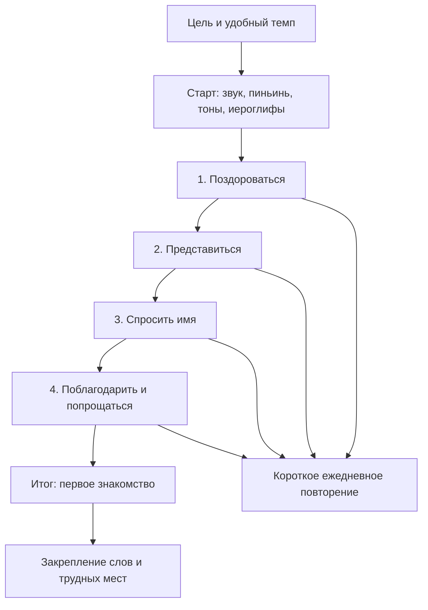

# ZhPath: самостоятельное обучение и карта пилота

24.10.2026. Продуктовое предложение по запросу пользователя. Это проект
учебного маршрута, а не новая опубликованная программа. Рабочие материалы,
аккаунты, роли и результаты не менялись.

## Роли

STUDENT учится самостоятельно: проходит подготовленные уроки, тесты, повторяет
слова. EDITOR готовит и исправляет материалы, аудио и черновики; не публикует
их и не управляет пользователями. ADMIN может также публиковать и управлять
ролями. Это подтверждено server/security.ts, а не предположение о продукте.
Редактор не является личным учителем, не выдаёт индивидуальные домашние задания
и не обязателен для прохождения. На старте достаточно владельца-администратора.
Отдельную роль редактора можно оставить для будущего методиста, не показывая
её ученику и не создавая систему классов, расписаний или обязательных проверок.

Рекомендация для следующего изменения навигации: одна точка «Управление» для
сотрудников; внутри — материалы, аудио, пользователи. Главный экран ученика
посвятить следующему учебному действию. Роли/права сейчас не удалять.

## Сравнение официальных описаний

Это кабинетное исследование открытых страниц на 24.10.2026, не тест платных
подписок, не сравнительный эксперимент и не доказательство удержания аудитории.

| Продукт | Описанная система | Что полезно ZhPath |
|---|---|---|
| Duolingo | Последовательный путь, небольшие уроки, повторение; серия дней | Одна очевидная кнопка продолжения, короткая сессия, видимый прогресс |
| HelloChinese | Короткая игровая программа, чтение/письмо/речь, видео носителей, SRS | Китайский изучать через звук, значение и иероглиф вместе |
| ChineseSkill | Краткие объяснения, разнообразная практика, аудио, письмо, учебные заметки | Теория непосредственно перед действием, справка рядом с ошибкой |
| Busuu | Повторение пройденных тем и персональная практика грамматики | Возвращать слабую тему в практику, пояснять причину повтора |

Источники:
- [Duolingo: структура пути](https://blog.duolingo.com/new-duolingo-home-screen-design/)
- [Duolingo: интервальное повторение](https://blog.duolingo.com/spaced-repetition-for-learning/)
- [Duolingo: серия дней](https://www.duolingo.com/help/what-is-a-streak)
- [HelloChinese: функции](https://www.hellochinese.cc/)
- [ChineseSkill: программа и практика](https://www.chineseskill.com/)
- [Busuu: повторение грамматики](https://help.busuu.com/hc/en-us/articles/12575126438674-What-is-Grammar-Review)

Busuu перечисляет конкретные поддерживаемые языки для Grammar Review;
эта ссылка не доказывает наличие такого режима для китайского. Функции продуктов
могут различаться по языку, платформе и подписке. Мы заимствуем принцип, не контент.

## Предлагаемая карта

Карта показывает текущий шаг, освоенные темы, что откроется дальше и почему
следующий урок пока закрыт. Время — ориентир до проверки с начинающими.
Один урок: цель → 1 короткое объяснение → пример → 2–3 действия → следующее
объяснение/практика → мини-тест → объяснение ошибок → результат и следующая кнопка.
Не отделять всю теорию в длинную обязательную лекцию перед первой практикой.

Пример первой сессии, 10–15 минут как гипотеза:
1. «Сегодня научитесь здороваться» и кнопка «Начать».
2. 1–2 минуты: что обозначают иероглифы, пиньинь и значки тонов.
3. Пример 你好: текст, аудио после приёмки, перевод, повторное прослушивание.
4. Узнать приветствие, сопоставить форму и значение; затем воспроизвести ответ.
5. Необязательное письмо 你/好: порядок черт → с образцом → без образца.
6. Мини-тест без наказания за ошибку, краткое объяснение и пересдача.
7. «Теперь вы умеете здороваться»; далее представление; слова уже в повторении.

## Вводная теория и источники

Проект вводного блока состоит из четырёх небольших карточек:
- Как читать экран: иероглиф / пиньинь / перевод / кнопка прослушивания.
- Звуки и тоны: сначала услышать и сравнить, затем увидеть пояснение; без
  обещания автоматической экспертной оценки произношения.
- Иероглифы: наблюдение порядка черт и короткое письмо; это отдельный навык,
  рисунок не переводится автоматически в ответ теста.
- Как учиться: сначала вспомнить ответ, затем раскрыть; ошибаться допустимо;
  после занятия вернуться к назначенному повторению.

Ссылки на источники помещать в раскрываемое «Подробнее», чтобы они не уводили
новичка с основного пути. Каждый блок должен иметь автора/проверяющего, дату,
основание использования аудио/текста, версию и переводы ru/kk/en. Открытая страница
не означает разрешение копировать её упражнения, видео или озвучку.

Для сопоставления последовательности «приветствие → имя» проверена официальная
[программа ChineseClass101 Absolute Beginner](https://www.chineseclass101.com/chineseclass101-absolute-beginner-s1-curriculum/).
Это справочный источник для проектирования, не лицензия и не предлагаемый импорт.
Собственные точные тексты вводной теории и фонетические примеры требуют
методической проверки; опубликованное содержание автоматически не заменять.

## Мотивация и интерфейс

- На главной: «Продолжить», карта модуля, короткий план на сегодня; подробные
  таблицы точности и истории — ниже либо по раскрытию.
- Показывать освоенное действие («могу спросить имя»), а не только проценты.
- Ошибка → понятное объяснение → ещё одна попытка; не блокировать учёбу жизнями.
- Добровольная дневная цель и мягкое возвращение после перерыва; не стыдить
  за пропущенный день и не требовать сохранять серию любой ценой.
- Чередовать слух, чтение, сборку фразы и письмо. Не усложнять новыми мини-играми,
  пока базовый путь не проверен новичками.
- Достижения связывать с навыками; не добавлять рейтинги ради рейтингов.
- После итога честно показать завершение пилота, а не всего HSK 1.

Проверка на небольшой пилотной группе: может ли новичок без подсказки начать,
понять следующий шаг и самостоятельно разобраться с ошибкой; дошёл ли до
первого результата; вернулся ли к повторению. Измерять понимание и обучение
вместе с возвратами, а не максимальное время внутри сайта. Численных обещаний
роста мотивации пока нет.

## Свет и контраст: внесённые изменения

Исходный почти белый фон и слабо различающиеся карточки усиливали ощущение
пустоты; бледный второстепенный текст заслуживает внимания. По одним снимкам
нельзя заключить, что всем пользователям нужна тёмная тема.

Добавлены светлая/тёмная/системная темы в профиль; выбор действует сразу,
сохраняется в браузере, учитывает смену системного режима и синхронизацию
вкладок. По умолчанию — режим устройства. Это настройка устройства, не БД;
на другом браузере выбирается отдельно. При запрещённом localStorage переключение
работает, сохранение между загрузками не гарантируется.

Светлая палитра: тёплый фон #F3F2EC, белые карточки, более заметные границы и
приглушённый зелёный. Тёмная: фон #121C18, карточки #1C2A23, светлый текст,
мягкий зелёный акцент. Поле письма оставлено светлой бумагой с тёмными чертами.

Расчёт основных непрозрачных пар: light text 9.19:1, secondary 5.42:1,
button 6.93:1; dark text 14.34:1, secondary 7.65:1, button 9.44:1.
Это проверка шести пар, не аудит всех состояний и полупрозрачных подписей.
[WCAG: обычный текст минимум 4.5:1](https://www.w3.org/WAI/WCAG21/Understanding/contrast-minimum.html).

Проверены TypeScript, production build, 614 переводов и scripts/test-theme.cjs:
сохранённый выбор, системный режим и его смена, синхронизация вкладок, ошибочное
значение и недоступное хранилище. Браузерная визуальная приёмка новых тем не
выполнена: управление браузером ранее отключено пользователем в Work.

## Порядок дальнейшего внедрения

1. Карта текущего пилота и ясная кнопка продолжения, сокращение начальной статистики.
2. Собственные вводные карточки и структура «объяснение → практика», приёмка методистом.
3. Принятые диалоги и аудио, перенос проверенных расширенных черновиков по отдельному решению.
4. Спокойные достижения и возврат к слабым темам; проверка удобства новичками.

В этой работе реализованы темы и корректировка палитры. Карта, новый учебный
сценарий и мотивационные механики выше — предложение, ещё не функции приложения.
