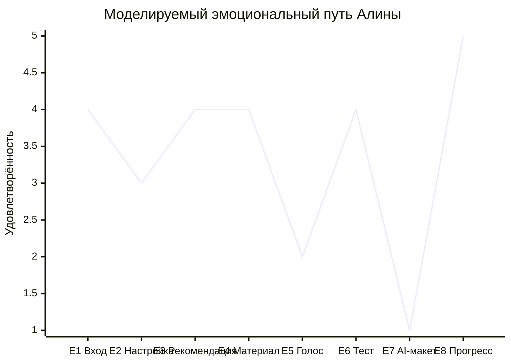
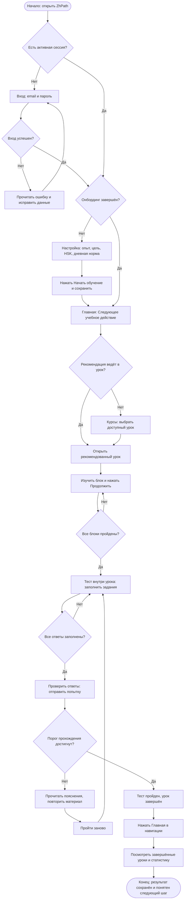
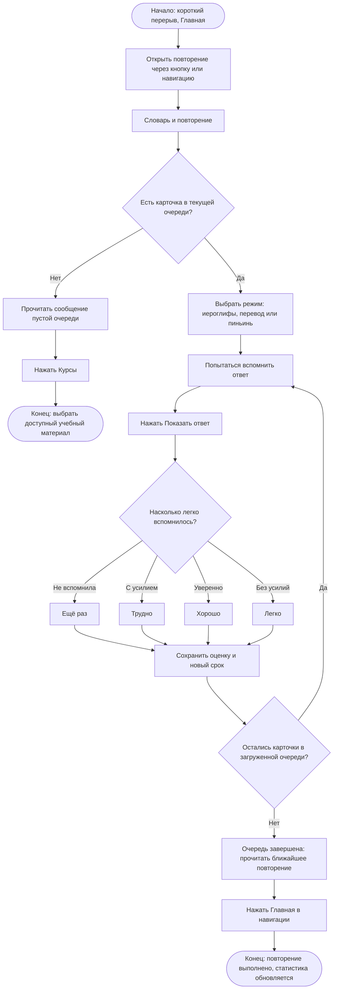
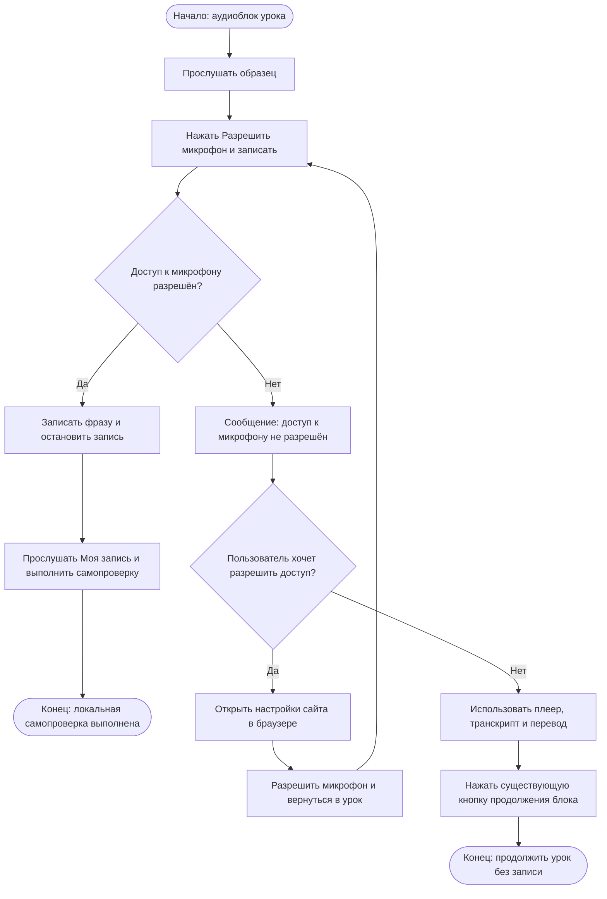

# Практическая работа 2.2

## Проектирование пользовательского пути Customer Journey Map и сценариев User Flow

**Проект:** ZhPath, платформа изучения китайского языка. **Дата:** 25 сентября 2026 года.

**Основание:** [практическая работа 2.1](practice_2_1.md), включая моделируемые ответы R1–R5, потребности N1–N7, проблемы P1–P7, цели G1–G3, требования T1–T7, Empathy Map и JTBD-1–JTBD-4.

**Цель:** связать потребности основной Persona с последовательностью действий, эмоциональными гипотезами и структурой реальных экранов.

**Persona не изменена:** Алина, 24 года, студентка магистратуры и младший аналитик. Начинает изучать китайский; обычно располагает 10–15 минутами; дома использует ноутбук, в дороге — смартфон. Основная задача: пройти посильный учебный шаг, понять ошибки и увидеть, что делать дальше.

**Граница достоверности.** CJM и Emotional Journey смоделированы по учебным данным 2.1. Это не результат наблюдения реальных пользователей. Экраны и переходы проверены статическим анализом кода; работа не подтверждает доступность серверов, конкретное наполнение БД или завершённую браузерную приёмку.

В текущем приложении нет диагностического теста и работающего AI-сервиса. Поэтому сценарий скорректирован: вместо диагностики — ручная настройка опыта и стартового HSK; вместо успешного AI-анализа — необязательное знакомство с существующим макетом после выхода из урока. Реальная обратная связь даётся тестом. Успешный основной User Flow не зависит от макета AI.

## Задание 1. Customer Journey Map

### 1.1. Условия сценария

Алина уже зарегистрирована и подтвердила email, но впервые приступает к обучению. Для выбранной модели пути доступны опубликованный урок с аудиоблоком и тестом, соединение с сервером и аудиоисточником. Очередь SRS пуста, начатых уроков нет — рекомендация ведёт к новому доступному уроку. Это условия сценария, а не сведения из пользовательской БД.

На повторном посещении этап 2 пропускается, если онбординг завершён. Этап 7 — необязательная исследовательская ветка: пользователь замечает кнопку AI после возвращения из урока на главную. При обычном успешном прохождении можно сразу перейти к этапу 8.

| Этап | Цель | Действия пользователя | Touchpoints | Мысли | Эмоции | Pain Points | Opportunities |
|---|---|---|---|---|---|---|---|
| E1. Вход | Получить доступ к обучению | Вводит email и пароль, нажимает «Войти» | Поле Email; поле «Пароль»; кнопка «Войти»; сообщение ошибки | «Надеюсь, быстро войду» | Спокойствие, 4/5 | Возможная ошибка входа требует повторного действия; это риск ветки, а не заявленный дефект | Сохранить существующие подписи, автозаполнение и обработку ошибки; проверять понятность сообщений |
| E2. Первоначальная настройка | Выбрать отправную точку | Выбирает опыт, цель, стартовый HSK и дневную норму; нажимает «Начать обучение» | «Опыт изучения»; «Стартовый уровень»; «Дневная норма (мин)»; кнопка сохранения | «Как узнать, подходит ли мне HSK 1?» | Неуверенность, 3/5 | P1: ручной выбор не подкреплён примерами навыков | O1/T1: примеры уровня; явно отделить самооценку от будущей диагностики |
| E3. Рекомендация | Быстро выбрать посильное действие | Читает «Следующее учебное действие», открывает рекомендованный урок | Карточка рекомендации; название урока; «Начать урок»; раздел «Повторение слов» | «Следующий шаг понятен. Успею ли я?» | Интерес, 4/5 | P2: время урока видно в каталоге, но не в карточке рекомендации | O2/T2: показать длительность рядом с CTA; дать выбор короткой практики |
| E4. Изучение блоков | Понять новые слова и примеры | Читает иероглифы, пиньинь и перевод, завершает блоки | Карточки лексики; номера блоков; шкала прогресса; кнопки «Продолжить» и «Назад» | «Вижу, сколько уже пройдено» | Вовлечённость, 4/5 | P2: отвлечение ограничивает время; сохранение блока уже поддерживается | O2: выделить оставшийся объём; сохранить возвращение к nextBlock |
| E5. Практика произношения | Сравнить фразу с образцом | Слушает запись, запрашивает микрофон; при разрешении записывает и слушает себя | Плеер образца; «Разрешить микрофон и записать»; диалог разрешения браузера; плеер «Моя запись» и чек-лист | «Я не уверена в тонах. Что делать, если запись недоступна?» | Напряжение, 2/5 | P4: техническое разрешение и отсутствие автоматической оценки могут затруднить самопроверку | O3/T4: заметное продолжение без записи; краткая помощь по разрешению; сохранять предупреждение о локальном хранении |
| E6. Тест и обратная связь | Проверить понимание и завершить урок | Заполняет задания, нажимает «Проверить ответы», читает результат и пояснения | Поля заданий; порог прохождения; кнопка проверки; «Ваш ответ» / «Правильный ответ»; «Пройти заново» | «Теперь вижу ошибку, но где повторить это правило?» | Облегчение с остаточной неуверенностью, 4/5 | P3: пояснения есть, переход к соответствующему блоку отсутствует | O4/T3: связать неверный ответ с блоком, сохраняя историю попытки |
| E7. Знакомство с AI-панелью, необязательно | Получить дополнительное объяснение | После выхода на главную открывает помощника, пробует кнопку «Объясни правило», закрывает панель | Плавающая кнопка AI; статус «HSK 1 • В сети»; «Объясни правило»; поле ввода; кнопка закрытия | «Он в сети, почему ничего не происходит?» | Разочарование, 1/5 | P7: интерфейс обещает взаимодействие, но запросы не отправляются | O5/T7: честный статус демонстрации; недоступная отправка; будущая альтернатива в виде перехода к учебным объяснениям |
| E8. Прогресс и дальнейшее повторение | Зафиксировать результат и следующий шаг | Закрывает панель, смотрит главную, при необходимости открывает повторение | «Завершено»; «Время занятий»; «Серия учебных дней»; «Открыть повторение»; режим и оценки SRS | «Занятие сохранено. Теперь понятно, что повторять» | Удовлетворение, 5/5 | P5: нужно разобраться в оценках повторения; P6: статистику можно ошибочно принять за уровень HSK | T5: примеры оценок SRS; O5/T6: итог в терминах учебных действий, не сертификации уровня |

Во всех восьми этапах указано минимум две конкретные точки взаимодействия. Системный диалог разрешения микрофона является внешней по отношению к интерфейсу приложения точкой контакта.

### 1.2. Связь CJM с результатами 2.1

| Основание из 2.1 | Этапы | Как оно использовано |
|---|---|---|
| JTBD-1, G1, N1–N2 | E2–E4 | Ручной старт, понятное следующее действие и сохранённый блок |
| JTBD-2, G2, N3 | E6–E7 | Разбор ошибок доступными средствами; выявление разрыва ожиданий от AI |
| JTBD-3, G2–G3, N4–N5 | E5, E8 | Продолжение без голоса и текстовое повторение |
| JTBD-4, G3, N6–N7 | E7–E8 | Достоверность статуса функций и интерпретация результата |
| Empathy Map: «Что повторить дальше?» | E3, E8 | Рекомендация в начале и план повторения в конце |

Техническая основа этапов: [App.tsx](../../src/App.tsx), [Auth.tsx](../../src/pages/Auth.tsx), [ProfileForm.tsx](../../src/components/ProfileForm.tsx), [Dashboard.tsx](../../src/pages/Dashboard.tsx), [Lesson.tsx](../../src/pages/Lesson.tsx), [VoicePractice.tsx](../../src/components/VoicePractice.tsx), [QuizPanel.tsx](../../src/components/QuizPanel.tsx), [AiTutorPanel.tsx](../../src/components/AiTutorPanel.tsx), [Reviews.tsx](../../src/pages/Reviews.tsx).

## Задание 2. Emotional Journey

Шкала: **1** — крайне негативный опыт; **2** — негативный; **3** — нейтральный; **4** — положительный; **5** — очень положительный. Числа выражают гипотезу об одном смоделированном прохождении Алины. Они не получены из опроса, телеметрии или измерений.

| Этап | Эмоциональное состояние | Оценка 1–5 | Причина |
|---|---|---:|---|
| E1. Вход | Спокойствие | 4 | Знакомая форма с двумя основными полями |
| E2. Настройка | Неуверенность | 3 | Стартовый HSK нужно выбрать самостоятельно |
| E3. Рекомендация | Интерес | 4 | Предложено конкретное следующее действие |
| E4. Материал | Вовлечённость | 4 | Видны блоки и сохранённый прогресс |
| E5. Голос | Напряжение | 2 | Нужно разрешить микрофон и самостоятельно сравнить произношение |
| E6. Тест | Облегчение | 4 | Есть результат, правильные ответы и объяснения |
| E7. AI-макет | Разочарование | 1 | Статус «В сети» не соответствует возможности получить ответ |
| E8. Прогресс | Удовлетворение | 5 | Реальный результат урока сохранён, виден следующий учебный шаг |

### График эмоционального пути

Если Markdown-просмотрщик не поддерживает `xychart-beta`, таблица выше остаётся точным текстовым представлением графика. Этап E7 обозначает ветку с исследованием макета; при её пропуске оценки остальных этапов остаются гипотетическими и требуют отдельной проверки.

### Интерпретация

**Самый проблемный этап — E7 (1/5).** Спад с 4 на E6 до 1 на E7 связан с разрывом между ожиданием помощи и статичным интерфейсом. Причина подтверждается кодом панели; величина эмоционального спада смоделирована.

Минимум два решения для E7:

1. **Управление ожиданиями:** заменить статус «В сети» явной пометкой «Демонстрация: AI-ответы пока недоступны»; сделать поле и отправку недоступными с объяснением. Это предложение T7, не выполненное изменение.
2. **Полезное продолжение:** предложить вместо отправки вопроса переход к существующим материалам и пояснениям теста. Для контекстного возврата потребуется отдельно спроектировать связь панели с выбранным уроком; в текущем коде такой связи нет.

**Дополнительное решение на плановый спринт 8:** при подключении AI различать ожидание ответа, результат и сбой; показывать повторный запрос и доступ к обычному учебному материалу. Эти состояния сейчас не реализованы.

**Второй спад — E5 (2/5).** Доступ к микрофону и самооценка тонов создают две разные трудности. Техническое улучшение — заметное продолжение без записи и помощь по разрешению. Учебное улучшение — короткий пример того, как сравнивать тоны и паузы; существующий чек-лист сохранить. ASR для такого улучшения не требуется.

**Наиболее положительный этап — E8 (5/5).** По гипотезе Persona получает удовлетворение от завершённого урока и следующего шага, несмотря на разочарование в AI. Такое восстановление эмоций не гарантировано: в реальном исследовании отдельно проверить, не приводит ли E7 к уходу до E8. Ошибка загрузки статистики также не должна интерпретироваться как положительный результат; в реализации для неё есть сообщение и повтор запроса.

## Задание 3. Pain Points

Приоритет — экспертная оценка влияния на достижение цели: **High** — риск остановки или существенной потери доверия; **Medium** — заметное затруднение при наличии обходного пути; **Low** — локальное неудобство. Приоритет не рассчитан статистически по пяти синтетическим профилям.

| Pain Point | Причина | Последствие | UX-решение | Приоритет |
|---|---|---|---|---|
| P1, E2: неясно, какой HSK выбрать | Самооценка без примеров навыков; диагностики нет | Сомнения до начала урока | T1/O1: примеры для уровня и пояснение ручного выбора; диагностика отдельно как будущая функция | Medium |
| P2, E3–E4: трудно оценить время шага | Рекомендация не показывает длительность, хотя каталог её содержит | Пользователь откладывает занятие или прерывает его | T2/O2: длительность рядом с рекомендацией и ориентир оставшегося объёма | Medium |
| P3, E6: трудно вернуться к объясняющему блоку | Обратная связь теста не связана прямым переходом с блоком | Повторяется ошибка, возрастает время поиска | T3/O4: привязка вопроса к материалу и действие «Повторить правило» | High |
| P4, E5: отказ микрофона воспринимается как тупик | Есть текст ошибки, но нет отдельного заметного действия продолжения без записи | Пользователь может уйти, хотя прогресс блока не зависит от записи | T4/O3: действие «Продолжить без записи» рядом с ошибкой и инструкция разрешения | High |
| P5, E8: неясно, какую оценку SRS выбрать | Четыре подписи требуют самостоятельной интерпретации | Неточная самооценка влияет на интервал повторения | T5: короткие примеры смысла «Ещё раз», «Трудно», «Хорошо», «Легко» | Medium |
| P6, E8: показатели воспринимаются как уровень языка | Рядом показаны активность и результаты тестов; требуется различать их смысл | Завышенная или заниженная оценка своих знаний | T6/O5: краткий итог освоенных действий; сохранить пояснение, что метрика не определяет HSK | Medium |
| P7, E7: AI выглядит доступным, но не отвечает | Статичное сообщение и кнопки без обработчиков отправки | Потеря доверия и риск прекращения занятия | T7/O5: честный демонстрационный статус, недоступный ввод и переход к материалам | High |

Все семь проблем связаны с CJM и кодами анализа 2.1. Работа не предлагает заново создавать уже имеющиеся поиск, сохранение прогресса, сообщения об ошибках или статистику. Предложения уточняют конкретные пробелы и не являются правками приложения.

### Проверка предложений в будущем исследовании

| Требование | Наблюдаемое действие на прототипе | Признак успешности |
|---|---|---|
| T1 | Объяснить смысл «Стартового уровня» | Пользователь отличает ручной выбор от результата тестирования |
| T2 | Выбрать занятие на короткий перерыв | Находит ориентир длительности без перехода в каталог |
| T3 | Вернуться к правилу после ошибки | Открывает соответствующий блок, не перебирая все блоки |
| T4 | Продолжить при отказе микрофона | Находит путь без записи и не считает её обязательной |
| T5 | Выбрать оценку по примеру вспоминания | Различает отсутствие ответа и ответ с усилием |
| T6 | Объяснить итоговую статистику | Не называет серию дней подтверждённым уровнем HSK |
| T7 | Попробовать обратиться к помощнику | Сразу распознаёт демонстрацию и находит доступное продолжение |

## Задание 4. User Flow

### Правила чтения схем

Все сплошные переходы в трёх схемах описывают существующую логику интерфейса и возможные действия пользователя. Прямоугольники — экраны или действия; ромбы — решения и проверки; округлённые узлы — начало и окончание. `#/lessons/:slug` — обозначение динамического адреса урока, а не буквальная ссылка.

Тест, его результат, голосовой тренажёр и AI-панель не имеют собственных маршрутов. Онбординг — условный экран App с ProfileForm, отдельного `#/onboarding` нет. Статистика находится на главной, отдельного `#/progress` нет. Основные переходы подтверждаются [routes.ts](../../src/app/routes.ts) и [App.tsx](../../src/App.tsx).

### Flow 1 — основной: урок, тест и сохранённый результат

**Начало:** подтверждённый пользователь открывает приложение. **Условия:** есть доступный урок с тестом, учебные запросы выполняются успешно. **Цель:** G1–G2, JTBD-1 и JTBD-2. Для первого занятия при пустой очереди пользователь выбирает новый урок; возвращающийся пользователь может продолжить начатый. Голосовая самопроверка необязательна. **Конец:** тест зачтён, завершение урока сохранено, прогресс виден на главной.

Существенные детали: «К тесту» появляется после прохождения материала; при неполных ответах отправка недоступна; порог задаётся конкретным Quiz, его нельзя всегда считать равным 80%. При незачёте показываются пояснения и «Пройти заново». Для возвращения к материалу сейчас используются номера ранее открытых блоков и «Назад»; прямая ссылка из неверного ответа — только T3. Незавершённые ответы хранятся в состоянии компонента до отправки, поэтому автоматическое сохранение черновика теста не заявляется.

Основание: [Lesson.tsx](../../src/pages/Lesson.tsx), [QuizPanel.tsx](../../src/components/QuizPanel.tsx), [learning.controller.ts](../../server/learning.controller.ts), [quiz.ts](../../server/quiz.ts). AI не включён в успешный путь, поскольку реального запроса и ответа нет.

### Flow 2 — альтернативный: повторение вместо нового урока

**Начало:** авторизованная Алина находится на главной, у неё мало времени. **Условия:** онбординг завершён; для ветки успешного повторения в аккаунте есть карточки с наступившим сроком или доступные новые карточки. **Цель:** G2–G3, JTBD-3. **Конец:** доступная очередь завершена и результат виден на главной; если карточек нет, определён следующий шаг через каталог.

После сохранения оценки карточка удаляется из текущей загруженной очереди. Схема не обещает её немедленного возвращения по оценке «Ещё раз»: следующий доступ определяется серверным расписанием и последующей загрузкой. Пустая очередь не означает ошибку или отсутствие всех карточек: возможны будущий срок и дневной лимит новых слов. Аудиорежим в коде ограничен наличием записи; поэтому для сценария в дороге выбран существующий текстовый режим.

Основание: [Reviews.tsx](../../src/pages/Reviews.tsx), [reviews.ts](../../src/api/reviews.ts), [review.controller.ts](../../server/review.controller.ts), [review.service.ts](../../server/review.service.ts).

### Flow 3 — сценарий ошибки: микрофон не разрешён

**Начало:** Алина находится в аудиоблоке доступного урока. **Ошибка:** браузер отклонил разрешение микрофона. **Цель:** продолжить учебное действие или восстановить запись. **Конец:** запись прослушана либо пользователь продолжил урок без записи. Это ошибка локальной записи, а не ASR или AI-сервиса.

В зависимости от позиции блока кнопка продолжения подписана «Продолжить», «К тесту» или «Завершить урок». Отдельной кнопки «Продолжить без записи» сейчас нет: именно её заметность предлагается в T4. Существующий `advance()` не требует наличия аудиозаписи. Настройки разрешения находятся в браузере, приложение не переключает их самостоятельно.

Основание: [VoicePractice.tsx](../../src/components/VoicePractice.tsx), [voiceRecorder.ts](../../src/app/voiceRecorder.ts), [LessonAudio.tsx](../../src/components/LessonAudio.tsx), [Lesson.tsx](../../src/pages/Lesson.tsx). В случае перезагрузки локальная запись теряется; сохранённый серверный прогресс урока имеет другой жизненный цикл. Ошибки устройства, размера записи и неподдерживаемого браузера также обрабатываются в компоненте, но не смешиваются с выбранной веткой отказа разрешения.

## Задание 5. Структура экранов

Ниже перечислены существующие экраны и состояния, используемые сценариями. Дополнительные экраны доступа включены для полноты реального пути аккаунта. Названия маршрутов не расширяются вымышленными страницами результатов или диагностики.

| № | Экран | Назначение | Основные элементы | Действие пользователя | Переход |
|---|---|---|---|---|---|
| 1 | Вход, `#/login` | Доступ к аккаунту | Email, пароль, «Войти», сообщение ошибки, ссылки доступа | Ввести данные, отправить форму | Онбординг или главная; при ошибке остаётся форма |
| 2 | Регистрация, `#/register` | Создание аккаунта | Имя, email, пароль, язык интерфейса | Отправить данные | Сообщение о результате; подтверждение через письмо, затем вход |
| 3 | Подтверждение email, `#/verify-email` | Подтверждение адреса по токену | Кнопка подтверждения, статус | Подтвердить email | Сообщение и ссылка «Войти» |
| 4 | Повтор письма, `#/resend-verification` | Повторный запрос подтверждения | Email, «Отправить повторно», статус | Запросить письмо | Остаётся экран со статусом; переход к письму вне приложения |
| 5 | Восстановление, `#/forgot-password` | Запрос ссылки сброса | Email, «Отправить ссылку» | Запросить восстановление | Статус и внешнее письмо |
| 6 | Новый пароль, `#/reset-password` | Смена пароля по токену | Новый пароль, «Сохранить пароль» | Сохранить пароль | Сообщение и ссылка входа |
| 7 | Первоначальная настройка, условный экран без отдельного маршрута | Подготовка обучения | Языки, опыт, цель, HSK, дневная норма, часовой пояс, напоминания | «Начать обучение» | Главная после сохранения |
| 8 | Главная, `#/` | Следующее действие и прогресс | Рекомендация, SRS-сводка, завершённые уроки, время, серия дней, точность | Начать/продолжить урок, открыть повторение | Урок, Reviews или каталог в зависимости от состояния |
| 9 | Курсы, `#/courses` | Поиск и выбор материала | Поиск, HSK, статус, сброс фильтров, карточки уроков, блокировки | Найти доступный урок | `#/lessons/:slug`; заблокированная карточка не открывается |
| 10 | Урок, `#/lessons/:slug` | Изучение материала | Название, номера блоков, прогресс, лексика, чтение, аудио, письмо | Читать и завершать блоки | Следующий блок; тест внутри урока; каталог или главная |
| 11 | Практика произношения, состояние аудиоблока | Локальная самопроверка речи | Запись, остановка, удаление, плеер, чек-лист, ошибки | Разрешить запись либо продолжить материал | Остаётся урок; разрешение изменяется в браузере |
| 12 | Тест, секция урока | Проверка ответов | Шесть поддерживаемых типов заданий, порог, кнопка отправки | Заполнить все задания, отправить | Результат в той же секции |
| 13 | Результат теста, состояние QuizPanel | Обратная связь и повторная попытка | Балл, зачёт/незачёт, ответы и пояснения, история до 10 попыток | Разобрать ответ, «Пройти заново» | Форма теста, ранее пройденные блоки либо выход через навигацию |
| 14 | Словарь и повторение, `#/reviews` | SRS и личный словарь | Очередь, режим, ответ, четыре оценки, поиск, избранное, заметки, история | Повторять, оценить вспоминание, сохранить заметку | Следующая карточка; при пустой очереди ссылка «Курсы»; главная через навигацию |
| 15 | Профиль, `#/profile` | Изменение настроек и завершение сессий | ProfileForm, статус напоминаний, «Выйти», «Выйти со всех устройств» | Сохранить настройки или выйти | Тот же экран после сохранения; форма входа после выхода |
| 16 | AI-панель, макет поверх страницы | Демонстрация будущего помощника | Статичное приветствие, кнопки подсказок, поле ввода, закрытие | Открыть и закрыть панель | Возврат к текущей странице; работающего диалога нет |

Экран AI-панели классифицирован как существующий **макет**, а не как работающая AI-функция. Плавающая кнопка скрыта на маршруте урока, и текущий Lesson не содержит встроенного помощника, несмотря на старый комментарий в App. Поэтому в CJM открытие панели происходит только после перехода на главную.

### Дополнительные существующие экраны вне пути Persona

| Экран | Роль и назначение | Причина исключения из основного сценария |
|---|---|---|
| `#/content`, ContentAdmin | Редактор/администратор: уроки, блоки, задания, черновики и публикация в пределах разрешений | Алина — ученица; подготовка содержания относится к другому процессу |
| `#/users`, UsersAdmin | Администратор: пользователи и роли | Не является учебной задачей |
| `#/media`, MediaLibrary | Редактор/администратор: учебные аудиоматериалы | Поддерживает авторскую подготовку урока |
| NotFound, неизвестный hash | Сообщение о неизвестном адресе | Ошибка адреса не выбрана основной ошибочной веткой |

Роли и права подтверждаются оболочкой App и серверными контроллерами, а не только наличием кнопок. Полная матрица прав не является задачей этой практической работы.

### Предлагаемые элементы, которых сейчас нет

| № | Экран / элемент | Назначение | Основные элементы | Действие пользователя | Переход |
|---|---|---|---|---|---|
| UX1 | **Предлагаемый экран:** вводная диагностика | Помочь выбрать старт после методической разработки теста | Задания, прогресс, результат с ограничениями, возможность пропуска | Пройти тест или оставить ручной выбор | Рекомендованный старт; маршрут ещё не определён |
| UX2 | **Предлагаемое состояние существующей панели:** честный статус AI | Устранить P7 до подключения провайдера | Пометка демонстрации, неактивная отправка, доступное продолжение | Перейти к материалам или закрыть | Существующие уроки/каталог; контекстный переход требует проектирования |
| UX3 | **Плановое состояние существующей панели:** работающий AI-преподаватель | Контекстное объяснение, проверка фразы, диалог | Запрос, ожидание, ответ, ошибка, лимит | Задать вопрос, повторить запрос при сбое | Остаётся панель; реализация относится к спринту 8 |
| UX4 | **Предлагаемый элемент результата теста:** «Повторить правило» | Связать ошибку с материалом | Ссылка на соответствующий блок | Открыть объяснение | Нужный блок существующего урока |

UX1 и UX2/UX4 — предложения практической работы. UX3 — направление уже существующего плана проекта; конкретная детализация состояний здесь является UX-предложением. ASR, TTS и расширенная система наград для выполнения этих сценариев не нужны и не представлены как реализованные.

## Вывод по практической работе 2.2

На основе единой Persona из 2.1 построен путь из восьми этапов, эмоциональная модель и три сценария: прохождение урока с тестом, альтернативное повторение слов и восстановление пути после отказа микрофона. Семь Pain Points связаны с конкретными этапами, требованиями и предлагаемыми решениями.

Главное препятствие для доверия в выбранном пути — несоответствие AI-макета ожиданию диалога. Для него предложены честный статус и доступное учебное продолжение. Практика голоса требует более заметного альтернативного действия; разбор теста — связи с материалом. При этом существующие сохранение прогресса, SRS, пояснения ответов и статистика уже обеспечивают полезный учебный цикл.

Полученная структура различает маршруты, вложенные состояния и будущие экраны. Диагностика не подменяет ручную настройку, локальная запись не называется ASR, готовые аудиофайлы не называются TTS, а рекомендация по правилам не называется AI. Все эмоциональные оценки и пользовательские выводы остаются гипотезами до реального исследования. Исходный код и интерфейс в рамках работы не изменялись.

## Контроль полноты двух работ

| Проверка | Где выполнено |
|---|---|
| Все 10 заданий 2.1 | Разделы «Задание 1» — «Задание 10» в practice_2_1.md |
| Не менее 5 респондентов и явно обозначенное моделирование | 2.1, задания 3–4: R1–R5, ответы на 10 вопросов |
| Не менее 5 Needs и 5 Pain Points | 2.1, задание 5: N1–N7 и P1–P7 |
| Не менее 3 Goals и 3 UX-возможностей | 2.1, задания 2 и 5: G1–G3, O1–O5 |
| Частоты и переход от высказываний к требованиям | 2.1, задание 6: указаны респонденты и T1–T7 |
| Persona, Empathy Map, не менее 3 JTBD | 2.1, задания 8–10: одна Persona, шесть блоков карты, четыре JTBD |
| CJM минимум из 5 этапов и минимум двух touchpoints на значимом этапе | 2.2, задание 1: E1–E8 |
| Emotional Journey: таблица и график | 2.2, задание 2: одинаковые оценки 4, 3, 4, 4, 2, 4, 1, 5 |
| Самый проблемный этап и минимум два решения | E7: статус демонстрации и переход к доступным объяснениям |
| Не менее 5 Pain Points в 2.2 | Задание 3: семь проблем с приоритетами |
| Основной, альтернативный и ошибочный User Flow | Задание 4: три Mermaid flowchart |
| Перечень реальных и предлагаемых экранов | Задание 5: маршруты отделены от состояний и предложений |
| Реализованные функции отделены от планов и гипотез | Реестр в 2.1; границы сценария и таблицы экранов в 2.2 |

## Источники

- [Практическая работа 2.1](practice_2_1.md) — все исходные пользовательские гипотезы, Persona и JTBD.
- «Дизайн_Практическая работа 2.2.docx» — требования к CJM, эмоциональной карте, Pain Points, трём User Flow и структуре экранов.
- [ROADMAP.md](../ROADMAP.md), [SPRINT_7.md](../SPRINT_7.md) — планы AI и ограничения приёмки текущих функций.
- Ссылки на конкретные компоненты и контроллеры приведены в соответствующих разделах; сведения о реальном использовании пользователями не заявляются.
